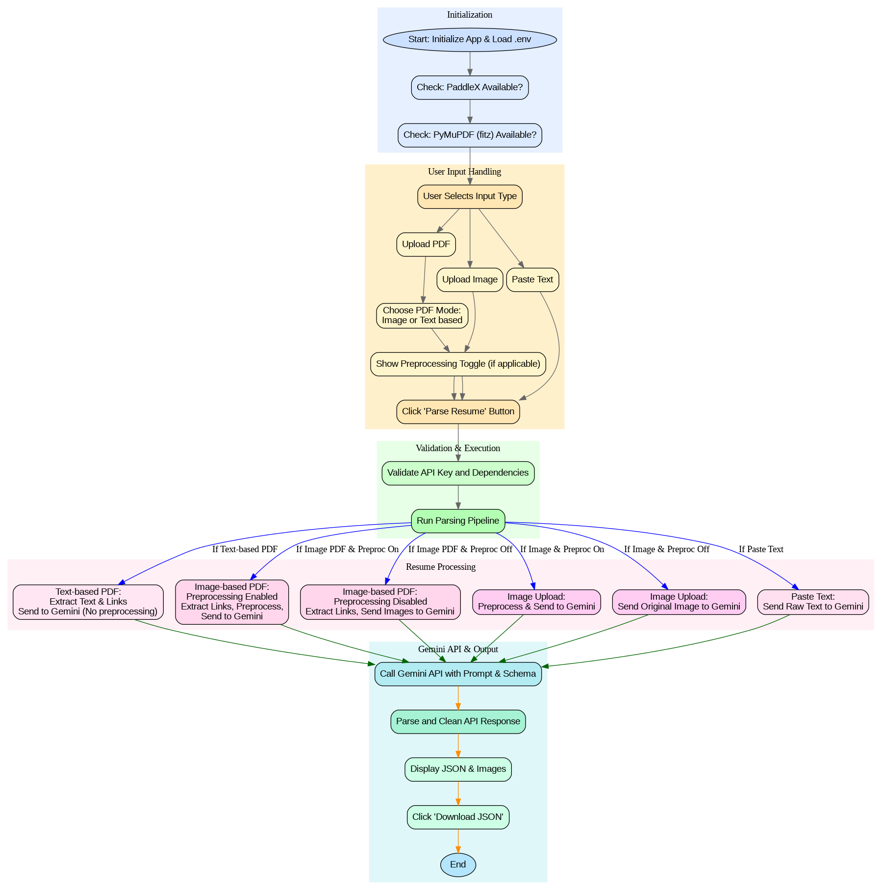

# 📄 AI-Powered Resume Parser

[](https://streamlit.io)
[](LICENSE)
[](https://www.python.org/downloads/release/python-3100/)
[](https://ai.google.dev/gemini-api/docs)
[](https://www.paddlepaddle.org.cn/)


Welcome to the AI-Powered Resume Parser! This project provides a robust tool for extracting structured information from resumes in various formats (PDF, Image, or raw text) using the power of Google's Gemini API, with optional image preprocessing using PaddleX and hidden link detection.

## 📁 Directory Structure
```plaintext
.
├── app.py                     # Streamlit web application
├── core_pipeline/
│   ├── __init__.py
│   ├── main.py                # Core pipeline logic (orchestrates preprocessing and parsing)
│   ├── parser.py              # Handles interaction with Gemini API for parsing
│   ├── preprocessing.py       # Manages image and PDF preprocessing (including PaddleX integration)
│   └── schema.py              # JSON response schema
├── .env                       # Environment variables (e.g., GEMINI_API_KEY)
├── requirements.txt           # Python dependencies
├── sample/
│   ├── input/                 # Contains sample input resume files (PDF, Image, Text)
│   ├── output/                # Contains JSON output files for sample inputs
│   └── flow.png               # Workflow diagram for README
└── README.md                  # Documentation
```

## ✨ Features

- Uses Google Gemini API for structured resume parsing
- Supports PDF (image/text), image, and raw text inputs
- Detects hidden links embedded in PDF files
- Optional image preprocessing using PaddleX for better accuracy
- Streamlit web app for interactive resume parsing
- JSON output for easy integration with downstream tools

## 🗺️ Workflow Diagram
To better understand the parsing process, refer to the workflow diagram below:


## 🛠️ Tech Stack

- Python 3.10
- Streamlit
- Google Gemini API
- PaddleX (optional)
- PyMuPDF (fitz)


## 🚀 Setup Instructions

1. Create & Activate Virtual Environment:
```bash
# macOS/Linux
python3.10 -m venv resume_parser_env
source resume_parser_env/bin/activate
```

```bash
# Windows
resume_parser_env\Scripts\activate
```

2. Install Dependencies:
```bash
pip install -r requirements.txt
```

3. (Optional) Install PaddleX:

- If you have a GPU and CUDA 11.8:

```bash
python -m pip install paddlepaddle-gpu==3.0.0 -i https://www.paddlepaddle.org.cn/packages/stable/cu118/
pip install "paddlex[base]==3.0.0"
```

- If using CPU:

```bash
python -m pip install paddlepaddle==3.0.0 -i https://www.paddlepaddle.org.cn/packages/stable/cpu/
pip install "paddlex[base]==3.0.0"
```
- More installation details: [PaddlePaddle](https://paddlepaddle.github.io/PaddleX/3.0-rc1/en/installation/paddlepaddle_install.html) Installation Guide. [PaddleX](https://paddlepaddle.github.io/PaddleX/3.0-rc1/en/installation/installation.html) Installation Guide.

- PaddleX is optional and only needed if image preprocessing is enabled.

4. Add API Key to `.env` File:
```bash
GEMINI_API_KEY="GEMINI_API_KEY"
```

5. Run the Application:
```bash
streamlit run app.py
```
- A local server will start and open the app in your default browser.


## ⚙️ How it Works:
- ✅ **Initialization Dependency Check:** The `app.py` checks for the presence of the Gemini API key, PaddleX, and PyMuPDF (fitz).
- ✅ **User Input Handling:** The user selects the input type (PDF, Image, or Paste Text) and provides the resume data. For PDFs, a processing mode (image-based or text-based) can be chosen, and for image inputs, preprocessing can be toggled.
- ✅ **Validation & Execution:** Upon clicking "Parse Resume," inputs are validated, and the `run_full_pipeline` function from `main.py` is invoked.
- ✅ **Resume Processing (`run_full_pipeline` in `main.py`):**

   - **PDF Input:**

        - **Image-based:** PDF pages are converted into images. If preprocessing is enabled and PaddleX is available, these images are enhanced. Both hidden links and processed images are then sent to Gemini.

        - **Text-based:** Text and hidden links are extracted directly from the PDF and sent to Gemini. No images are generated.

    - **Image Input:** The image is optionally preprocessed by PaddleX. The resulting (or original) image is then sent to Gemini.

    - **Text Input:** The raw text is sent directly to Gemini.
- ✅ **Gemini API Call:** The `parse_resume_with_gemini` function (in `core_pipeline/parser.py`) sends the prepared input (text and/or images) to the Gemini API with a specific prompt and schema for structured extraction.
- ✅ **Output Display & Download:** The parsed JSON response from Gemini is displayed in the Streamlit UI. If images were processed, their preprocessed versions are also shown. The user can download the JSON output.

## 📂 Sample Input & Output

Sample files are included in the repository for quick testing and reference.

```plaintext
sample/
├── input/     # Sample resume files
└── output/    # Corresponding parsed JSON outputs
```

> **Note:** You can use these samples to understand the expected input and output formats or replace them with your own resume files.

## ⚠️ Limitations

 - The **image-based mode** is generally more robust for complex layouts and works better for 1–3 pages PDF. However, it consumes more Gemini tokens, which can increase processing costs. Furthermore, if an image is already properly aligned and cropped, applying additional image preprocessing in this mode might inadvertently misalign or crop essential areas.

 - The **text-based mode** is faster and more cost-effective as it uses fewer Gemini tokens. However, it may miss information from purely visual elements, such as diagrams or specific formatting, that are not directly convertible to text.

## 📄 License

This project is licensed under the MIT License.  
See the [LICENSE](LICENSE) file for full details.


## 🙏 Acknowledgements

 - [PaddleX Preprocessing](https://paddlepaddle.github.io/PaddleX/latest/en/index.html#python-usage-doc-preprocessor)
 - [Gemini structured response](https://ai.google.dev/gemini-api/docs/structured-output)
